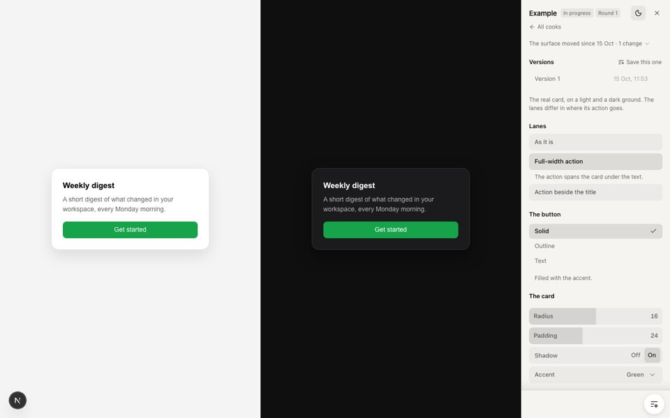
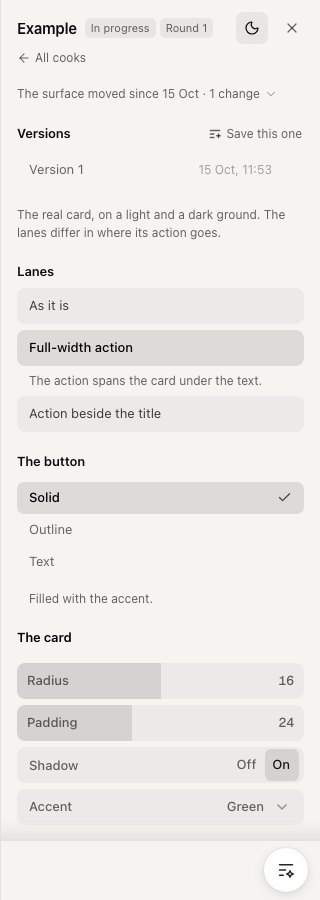

# visual-cook

A skill for [Claude Code](https://claude.com/claude-code). When you can't say how something should look, Claude builds a few versions of it inside your real app, and you pick one by looking.



## How it works

1. You ask Claude: *"Let's visual-cook the empty state on the dashboard."*
2. Claude builds a **cook**: a page in your app that shows the real component, plus a few versions of it. Claude sends you the link.
3. You open the link. In the sidebar on the right you switch between versions, move sliders, and click on anything that looks wrong to leave a note.
4. You answer Claude in a few characters: *"2"*, *"version 3"*, *"I pointed"*, or you paste the link.
5. Claude makes the next round, or puts the one you chose into the real page.

You never have to describe a look in words. You look and choose.

## Words you'll see

| Word | What it means |
|---|---|
| **Cook** | One page that asks one question about how something should look, e.g. "where does the card's button go?" |
| **Lane** | One version of the thing. Lane 1 is always what's live now, so you're always comparing against what you already have. |
| **Pick** | A question with a few named answers, e.g. button style: Solid, Outline or Text. |
| **Dial** | A slider, switch, dropdown or colour for "how much" questions: size, spacing, blur, speed. |
| **Version** | A saved snapshot of the whole cook (lane, picks and dials). "Version 2" means exactly that state. |
| **Decide** | Mark a pick as settled. It moves to the bottom so you can focus on what's still open. |
| **Retire** | Hide a lane you don't want. It isn't deleted, and you can bring it back. |
| **All cooks** | One page that lists every cook in the app, newest first. |

## What you need

- **Claude Code.**
- **A Next.js app** (App Router) **with Tailwind v4.** The sidebar is built for this. On any other setup the skill still works, but the cook won't have the sidebar.
- **git**, so the sidebar can tell you when the real code changed after a cook was made.

## Set it up (once per app)

**1. Get this repo.**

```bash
git clone https://github.com/ideel-1/visual-cook.git
```

**2. Give the skill to Claude Code.** This makes it available in every project:

```bash
mkdir -p ~/.claude/skills/visual-cook
cp visual-cook/SKILL.md ~/.claude/skills/visual-cook/
```

**3. Copy the cook files into your app.** Run this from your app's folder (the one that has `app/` in it), and change `../visual-cook` to wherever you cloned the repo:

```bash
mkdir -p components
cp -R ../visual-cook/harness/nextjs/app/. app/
cp -R ../visual-cook/harness/nextjs/components/. components/
npm install dialkit@1.2.0 agentation@3.0.2 lucide-react@1.16.0 motion@12
echo '/.cook/' >> .gitignore
```

**4. Turn on pointing.** In `app/layout.tsx`, add two lines:

```tsx
import { DevTools } from "@/components/dev/DevTools";

// inside <body>, right after {children}:
<DevTools />
```

**5. Check it works.** Run `npm run dev` and open [localhost:3000/dev/visual-cook](http://localhost:3000/dev/visual-cook). You'll see the All cooks page with one cook in it, **Example**. Open it and try everything in the sidebar.

When you don't need the example any more, delete `app/dev/visual-cook/example/`, `components/ExampleCard.tsx`, and its entry in `app/dev/visual-cook/index.ts`.

> **If your app keeps its code in `src/`**, copy into `src/app/` and `src/components/` instead, and in `app/dev/cook-drift/route.ts` change `const SRC = ''` to `const SRC = 'src/'`.

## Your first cook

In Claude Code, inside your app, say what you want to look at:

> *"Let's visual-cook the pricing card."*

Claude makes the cook, adds it to All cooks, and gives you the link. From there it's steps 3 to 5 above.

## The sidebar



From top to bottom:

1. **Name and round.** The moon/sun switches light and dark. The cross hides the sidebar, and so does the **H** key.
2. **All cooks.** Back to the list of every cook.
3. **The surface moved.** Only shows when the real code this cook uses changed after the cook was made. Before the next round, ask Claude to bring the cook up to date.
4. **Versions.** "Save this one" keeps everything as it is now. Tell Claude "version 1" and it knows exactly which state you mean.
5. **Lanes.** The versions of the thing. ← and → step through them. Hover one to retire it.
6. **Picks.** Click an answer. Hover the question to **Decide** it.
7. **Dials.** Move them and watch the page change.
8. **Pointing.** The button in the bottom corner. Turn it on, click any element, write what's wrong. Then tell Claude "I pointed".

<br clear="right">

## Where your answers are kept

Everything you do in the sidebar is saved where Claude can read it later. So if you come back to a cook next week, Claude picks up where you left off.

| You… | It's saved in… |
|---|---|
| move a lane, pick or dial | the page's link, so copying the link copies the state |
| save a version | `.cook/versions.json` |
| decide a pick, or retire a lane | `.cook/decided.json` |
| point at something | `.cook/pointed.jsonl` |

`.cook/` is a folder in your app that git ignores. It stays on your machine.

## Built on DialKit and Agentation

The sidebar uses two open packages instead of reinventing them:

- **[DialKit](https://github.com/joshpuckett/dialkit)** by Josh Puckett (MIT) makes the **dials**: sliders, switches, dropdowns and colour pickers. They're placed inside the sidebar so they look like the rest of it, and every value is written into the page's link.
- **[Agentation](https://www.npmjs.com/package/agentation)** (PolyForm Shield 1.0.0) makes **pointing**: click an element, write a note, and the note is saved with exactly which element you meant. Check its licence fits what you're building.

## Common questions

**Is it safe to ship?** Yes. Cooks only exist while you run the app locally. In a production build, every page under `/dev/` shows "not found" and the pointing toolbar isn't included.

**Does every cook get its own copy of the sidebar?** No. You copy the files once per app, and every cook in that app uses that one copy. If the app doesn't have the files yet when you start a cook, Claude copies them in.

**Does my copy update when this repo changes?** No. When you start a cook in that app, Claude can bring the copy up to date from the skill.

**What if I'm not on Next.js?** The skill still works the same way (real components, lane 1 is what's live, one difference per lane), but the cook won't have the sidebar.

## Why it works this way

Most visual work goes wrong in one of three ways: arguing about vague words like "cleaner", choosing between new ideas with nothing to compare them to, or losing the decision once the conversation ends. So:

- **Show, don't argue.** "How much" questions (spacing, weight, contrast, timing) are answered by looking, not by talking. A vague word like "cleaner" becomes a few lanes, one for each thing it could mean.
- **Lane 1 is what you have now.** The question is always "does anything beat what's already there?"
- **Each lane changes one thing,** written in its label. If two lanes can't be told apart in a few words, one of them goes.
- **Your answer is kept where you gave it:** the link, the version, the decided pick, the note.

## Versions of this skill

- **v4 (Oct 2026):** the sidebar, shipped as real files in `harness/nextjs/`. Your answer is now a click or a link, not something you type out.
- **v3:** the cook page itself is the main thing; Claude only asks you questions when every lane is rejected.
- **v2:** cooks are kept forever as the record of what was decided, instead of a separate design document.
- **v1:** an interview that pinned down vague design words.

This repo is a published copy of a skill used daily in private projects; it's updated here when the private one changes.

## Licence

MIT, for this repo. DialKit and Agentation have their own licences, linked above.
